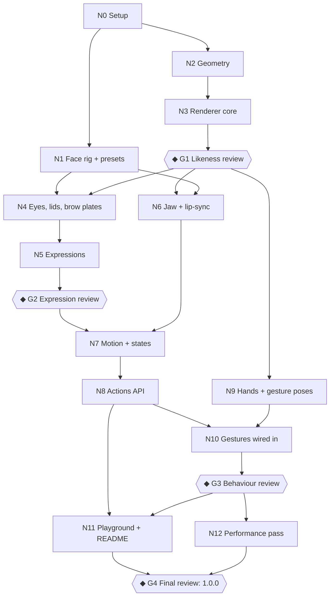

# Plan: one robot, many faces (robot-heads 1.0)

Replace the TV robot and its four shapes with a single dome-headed giant: a lit 3D head on a neck and shoulders, with
a face that acts through glowing eyes, brow plates and a hinged jaw. References: `inspiration/frames/` (175 stills
sorted by expression) and `inspiration/persona.md` (character, voice and behaviour). Both stay private: `inspiration/`
is git-ignored, and no film name appears in code, docs, the package or the site.

Work happens directly on `main`, one commit per node, never pushed. **◆ nodes are review gates**: work stops there
until Leo approves.

## DAG



Parallel lanes: `N1 ∥ N2`, and after G1 the lanes `N4 → N5`, `N6` and `N9` are independent of each other.

## Nodes

### N0: Setup
- Add `inspiration/` to `.gitignore`. Commit this plan.
- New source folder `src/robot/` (geometry, light, render, rig, sim, audio). `src/tv/` is deleted at the end of N3,
  once nothing imports it.
- A dev-only **lab page** in the playground (`/lab`, served only by `vite dev`). It shows renders side by side with
  reference frames read from `inspiration/` through the dev server, so it is never built or deployed.
- **Done when:** the lab page loads locally, showing the reference contact sheets.

### N1: Face rig and expression presets
- `rig.ts`: one flat parameter set that every expression, state and action writes into:
  - per eye: `lidTop`, `lidBottom`, `lidAngle` (brow-plate tilt), `glow` (intensity), `size`, `shape` (0 circle →
    1 pentagon), `pupil` (0 none → 1 red pinpoint), `color`, `gazeX`, `gazeY`
  - jaw: `open`, `smile` (curve of the jaw line), `side`
  - head offset: `yaw`, `pitch`, `roll`; extra: `dent` (0 dented → 1 popped out)
- Critically damped springs per parameter (heavy: ~250ms, with a little overshoot on the head). Colours blend in
  linear RGB.
- Presets, tuned in N5: `neutral`, `curious`, `happy`, `joyful`, `sad`, `sheepish`, `sleepy`, `suspicious`,
  `content`, `surprised`, `determined`, `attack`, `defense`, `peaceful`, `asleep`.
- **Done when:** unit-free pure TS that typechecks, with a tiny test that blending converges and stays bounded.

### N2: Geometry (reuses the lathe and loft code in today's `geometry.ts`)
- **Head:** a lathed bullet dome, taller than wide. A raised centre ridge runs from a small spike on top down to
  between the eyes. Separate brow and cheek planes give the "face plate". There's a dent above one eye: check which
  side against `02-curious` and `14-head-shape`.
- **Sockets:** two round recesses, baked into the face-plate relief (lip, inner shadow, rim) like today's screen lip.
- **Jaw:** a separate mesh, hinged at the sides of the head under the brow line.
- **Neck:** stacked lathed rings. **Shoulders:** two riveted slabs and a collar plate, cropped at the frame bottom.
- `frameFor`: at rest, head + neck + shoulders fill the `size` box. Motion, hands and glow draw past it (0.3.0 contract).
- **Done when:** the meshes build, with a debug wireframe render on the lab page.

### N3: Renderer core
- The same per-quad lighting (`light.ts`) with a **weathered gunmetal** material: dark grey-brown, low gloss, soft
  spec, a grime gradient towards the bottom, and riveted panel seams in the baked relief.
- Painter's order for head / jaw / neck / shoulders as the head yaws, pitches and rolls on the neck.
- Static relief is baked once per size and reused.
- Delete `src/tv/`, the `shape`/`model`/`antenna`/`trimColor`/`screenColor` props and `robotHeadShapes`. The eyes are a
  placeholder (plain discs) until N4.
- **Done when:** the head renders in neutral front, 3/4 and profile on the lab page, at ≤2ms per frame at 400px with 2×
  pixel density.

### ◆ G1: Likeness review
Lab page: front / 3/4 / profile / low-angle renders next to `14-head-shape` and `01-neutral`. Leo checks the proportions,
the dome and ridge, jaw size, socket spacing, the dent, the neck and shoulders, and the material. **Approve or list fixes.**

### N4: Eyes, lids and brow plates
- Each eye's glow is drawn in face-plane space (the same affine trick as today's screen), inside its socket, so it slides
  correctly as the head turns.
- **Lids and brow plates:** dark shapes that clip the disc from the top and bottom. Tilting them gives sad or angry. The
  glow moves inside the socket for gaze.
- Shape morph circle → pentagon, and a red pinpoint pupil inside a darkened socket, for defense mode.
- Bloom from the low-resolution pass, tinted by eye colour. A faint glow spills onto the brow and cheek planes.
- **Done when:** every rig parameter visibly does its job on the lab page (sliders).

### N5: Expressions
- Tune the 15 presets against their folders: neutral `01`, curious `02`, happy/joyful `03` + `10`, sad/sheepish `04`,
  sleepy/content/suspicious `05`, peaceful/asleep `06` + `13`, determined/attack `07`, defense `08`, surprised from the
  wide-eye frames in `09`.
- **Scripted transitions** taken frame by frame from the references:
  - defense on: white → red pentagon → red pinpoint (6825–6834); off: 8309–8311
  - blink: 9920–9929
  - wake: 10550–10562
  - lids opening from slits: 4506–4524
- **Done when:** the lab expression sheet is complete (15 renders, each next to its reference).

### ◆ G2: Expression review
Lab page: the expression sheet, plus the four scripted transitions playing in a loop. **Approve or list fixes.**

### N6: Jaw and lip-sync
- `mouth` prop (0–1). `audio` prop: a MediaStream, an `HTMLMediaElement` or an AudioNode, read through one shared,
  lazily created AudioContext and an analyser per source (RMS with attack/release smoothing). It resumes on the first
  user gesture.
- A procedural flap for `speaking` when neither prop is set: short phrases with pauses, slow (persona: "slow and
  rumbly, with gaps").
- Tuned on the lab page against the clips in `inspiration/audio/` (dev-only, never shipped).
- **Done when:** a lab clip plays with a jaw that reads as speech, with no chatter on music beds.

### N9: Hands and gesture poses
- Low-poly blocky riveted hands: a palm, four fingers and a thumb, 2–3 joints each, same material.
- Key poses with entry and exit paths (rising from below the frame) for: head scratch, hands at temples, chin/admire,
  wave, hands up.
- The hands are depth-sorted against the head and jaw (e.g. a scratching hand goes behind the dome's edge).
- **Done when:** each gesture plays on the lab page and matches its reference frames.

### N7: Motion and states
- Rewrite the sim for weight: slow eases, an overshoot then a careful correction, no hops. The head moves on the neck,
  and the shoulders shift a little.
- Pointer following: the eyes lead and the head follows. `lookAt` (a point or an element ref) overrides it.
- Idle life: slow blinks every 2–6s, small saccades, an occasional sigh-settle.
- States (`expression` replaces the face and keeps the motion):

| State | Face | Motion |
|---|---|---|
| idle | neutral | slow glances, blinks, an occasional curious tilt |
| thinking | curious, half-lidded | looking up to the side, tilt |
| searching | suspicious → curious | slow head sweep, eyes dart |
| listening | slightly wide | head cocked, small nods |
| speaking | neutral | jaw from N6 |
| working | content, looking down | careful steady bobbing |
| happy | joyful | a bounce that settles |
| error | sheepish/sad (never red) | slow head shake, droop |
| sleeping | asleep | eyes dim out, head droops, slow breathing |

- Click reaction: blink → a surprised flash → a settling nod.
- **Done when:** every state runs on the lab page and the switches between them blend without pops.

### N8: Actions API
- The ref becomes a handle: `{ canvas, play(action, opts?): Promise<void> }`. A new action interrupts the current one,
  and the face blends back to the current expression afterwards.
- Actions: `blink`, `nod`, `shake`, `wake`, `defense` (on → hold → off), `lookAt`, `beacon` (a soft glow pulse from the
  jaw bolt: "I'm still here").
- **Done when:** every action plays and resolves on the lab page, including when interrupted.

### N10: Gestures wired in
- Gesture actions: `scratch`, `temples`, `chin`, `wave`, `handsUp`. Automatic gestures every 20–40s by state:
  - thinking → scratch or chin
  - searching → chin
  - error → handsUp
  - idle → a rare wave
- **Done when:** gestures run both on demand and automatically without fighting other actions.

### ◆ G3: Behaviour review
Lab page: all states, actions, gestures and lip-sync with a clip. **Approve or list fixes.**

### N11: Playground and README
- Rebuild the public playground (no film frames or clips):
  - expression grid, state and action buttons, colour and eye-colour controls
  - a microphone lip-sync demo and a `lookAt` demo
  - a frame-time readout
- README: the new API and its expressions, states, actions and lip-sync. Copy in the robot's voice ("Hmm?", "I fix.").

### N12: Performance pass
- Profile at 120, 240 and 400px with 1–3 heads. Target ≤2ms per frame per head.
- IntersectionObserver pause off screen. Reduced motion shows a static rest pose with expressions still applied.
- No allocations in the frame loop, and bake caches with a size limit.

### ◆ G4: Final review
Bump to 1.0.0, typecheck, build and run the playground. **Leo approves, then commit. Pushing is Leo's call.**

## Public API (target)

```tsx
<RobotHead
  state="thinking"            // idle | thinking | searching | listening | speaking | working | happy | error | sleeping
  expression="curious"        // optional face override (15 presets)
  size={240}
  color="#4a4440"             // shell
  eyeColor="#fff3e0"          // glow (amber/blue moods); defense/attack override it
  lookAt={inputRef}           // or { x, y } in page px
  mouth={level}               // 0–1, or:
  audio={mediaStream}         // MediaStream | HTMLMediaElement | AudioNode
  speed={1} paused={false} interactive floorShadow seed={0.3}
  ref={robot}                 // robot.current.play('wake'), play('scratch'), …
/>
```

## Decisions log
Settled during the interview and in the ledger: personal use, with no name or branding from the film. States and
expressions both in the API. Lit 3D with weathered gunmetal. Head, neck and shoulders in frame. Gestures, lip-sync
(both inputs), actions and `lookAt` are in scope. Hands appear only during gestures. Aimed at 1–3 heads at 120–400px.
Breaking 1.0.0. Work on `main`. Red eyes are never used for ordinary errors (persona). Sound playback is out of scope:
the library is visual only.
