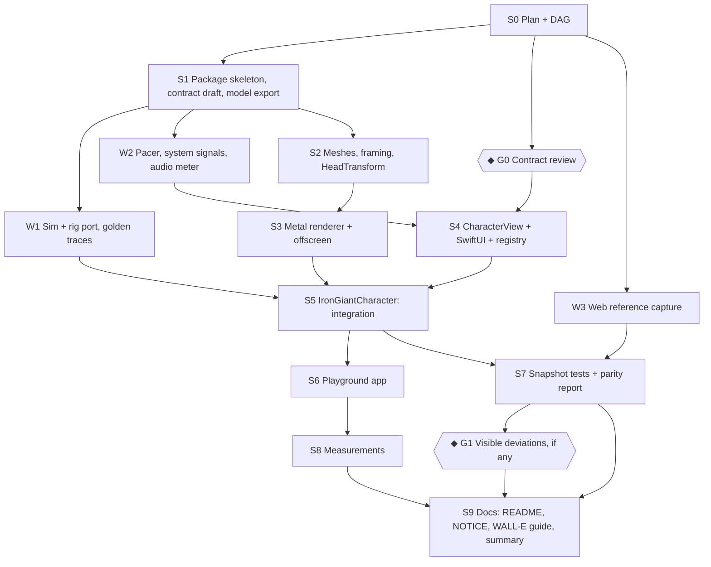

# DAG: the Swift/Metal port

Coordinator: this worktree (`leomleao/swift-metal-port`). Workers branch from the coordinator's branch after S1 and
are merged back locally. Nothing is pushed. ◆ marks a gate that waits on Leo.

Parallel lanes once S1 lands: **W1 ∥ W2 ∥ W3 ∥ (S2 → S3)**, while G0 is with Leo.

## Nodes

### S0: Plan and DAG (coordinator)
- `PLAN.md`, `DAG.md`.
- **Done when:** both are committed.

### S1: Package skeleton (coordinator)
- Root `Package.swift`: tools 6.4, `.macOS(.v27)`, Swift 6 mode; targets `CharacterKit`, `IronGiant`,
  `RobotPlayground` (executable), `CharacterKitTests`, `IronGiantTests`. `.gitignore`: `.build/`, `.swiftpm/`.
- CharacterKit vocabulary, appearance and the protocol **as drafted** (provisional until G0).
- `scripts/swift/export-model.mjs`: reads `src/robot/model.ts` and writes `Sources/IronGiant/Model/ModelData.swift`
  (same base64, same constants). `NOTICE` with the EMA Labs CC BY 4.0 attribution.
- **Done when:** `swift build` and `swift test` pass (empty tests), and `pnpm run typecheck` still passes.

### W1: Sim and rig port, golden traces (worker)
- `Sources/IronGiant/Sim/Rig.swift`, `Sim.swift`: a faithful port of `src/robot/rig.ts` and `src/robot/sim.ts`.
  Float32 storage where TS uses `Float32Array`; the RNG bit-exact with `Math.imul`/`>>>` semantics; the same
  substepping, timings, constants and comments' intent. Actions resolve through a callback or continuation and
  report completed/interrupted.
- `scripts/swift/sim-trace.mjs` (Node, runs the TS sim directly): fixed seeds × scenarios (every state; state
  switches; every action incl. interrupted ones and `defense` with a custom hold; pointer and lookAt; external mouth
  levels; speed 0.5/2) → JSON fixtures in `Tests/IronGiantTests/Fixtures/`.
- Tests: the Swift sim reproduces every trace (pose + face every 1/60 s) within tolerance; springs converge and stay
  bounded; expression table equals TS; sequences; action outcomes.
- **Done when:** `swift test --filter IronGiantTests` passes and the traces cover every state and action.

### W2: Pacer, system signals, audio meter (worker)
- `Sources/CharacterKit/Pacing/RenderPacer.swift` (pure policy, `PacingSignals`, `PacingPolicy`, `RenderBudget`),
  `SystemSignals.swift` (every source in PLAN §5, main-actor, publishing changes to the pacer),
  `Sources/CharacterKit/Audio/AudioLevelMeter.swift` (`SpeechLevelSource`), `SpeechPlayer.swift`.
- Tests: the policy table (each row and combinations, speaking floor, forced budget), meter mapping on synthetic
  buffers (silence → 0, gate, a −20 dBFS sine → expected level), meter thread-safety.
- **Done when:** tests pass under Swift 6 strict concurrency with no warnings.

### W3: Web reference capture (worker)
- A way to render the TS head paused at a fixed size and scale with a transparent background, for every state
  (its still pose and face) and every expression (over `idle`), and save the canvas's own pixels as PNG to
  `docs/swift-port/reference/web/`. Uses the existing playground or the dev-only lab page; the captured page and
  the script live in `site/src/lab/` and `scripts/swift/`, never in the published site.
- Records the exact size, device pixel ratio and colours used in `reference/web/README.md`.
- **Done when:** 9 + 17 PNGs at 240 CSS px and 2× exist, and re-running the script reproduces them.

### S2: Meshes, framing, HeadTransform (coordinator)
- Decode the model, build flat GPU vertex arrays (full and low), compute the jaw panel and jaw top, `craniumFront`,
  `frameFor`, `HeadTransform` (head, jaw, normals) in Swift.
- Tests: triangle counts and bounds; jaw panel, framing and projected points equal TS values.
- **Done when:** tests pass.

### S3: Metal renderer and offscreen rendering (coordinator)
- MSL: mesh vertex/fragment (pose, hinge, smile bend, back-face rule, lighting, display curve), mouth plate, seams,
  floor shadow, ink composite, eye (socket, glow, pentagon, iris, lids, seam), bloom.
- `IronGiantRenderer`: pipelines, buffers, per-tier MSAA and mesh, and rendering into any texture.
- **Done when:** still poses render offscreen to PNG and look right next to the web references.

### ◆ G0: Contract review (Leo)
- PLAN §3. Approve, or list changes; then the contract is frozen.

### S4: CharacterView, SwiftUI wrapper, registry (coordinator)
- `CharacterView` (MTKView, display link, pacer, pointer polling, click → poke, `hitTest`, framing to bounds,
  transparent), `CharacterViewRepresentable`, `CharacterRegistry`, `OffscreenRenderer`.
- **Done when:** a placeholder character (a test double) renders in a transparent panel, and pacing changes
  frame rates when signals change.

### S5: IronGiantCharacter (coordinator)
- Conformance: sim (W1) + renderer (S3), speech source, lookAt in screen points, palette, still pose, hit-testing.
- Protocol-semantics tests: unsupported action, interruption, still resolution, hidden-time actions.
- **Done when:** all tests pass and the character runs in a `CharacterView`.

### S6: Playground app (coordinator, or a worker if one is free)
- `swift run RobotPlayground`: state, expression, action dock (with defense hold), shell and eye swatches + custom,
  speed, paused, interactive, floor shadow, seed, a mouth slider with "auto", an audio-file lip-sync demo, a
  quality-tier override, fps/CPU/GPU readouts, and a floating transparent-panel mode with hit-testing.
- **Done when:** every control works.

### S7: Snapshot tests and parity report (coordinator)
- Baseline PNGs per state and expression; snapshot tests with tolerance and a record mode.
- `PARITY.md`: a side-by-side contact sheet against W3's references, mean difference per image, the checklist
  ticked, and the deviations.
- **Done when:** snapshot tests pass and the report is written.

### ◆ G1: Visible deviations (Leo, only if any)
- If the side-by-side shows a difference that is a trade-off rather than a bug, Leo decides.

### S8: Measurements (coordinator)
- CPU and GPU at idle and speaking, per tier, in `MEASUREMENTS.md`.

### S9: Docs and wrap-up (coordinator)
- README: a Swift section. `NOTICE`. `WALL-E.md`: what a second character implements. A summary of what was
  built, the measurements and the deviations.
- **Done when:** committed on the branch, not pushed.

## Status (2026-10-24)

| Node | Who | Result |
|---|---|---|
| S0 plan + DAG | coordinator | done |
| G0 contract review | Leo | approved as drafted |
| S1 skeleton | coordinator | done |
| W1 sim + rig port | worker (`leomleao/swift-sim-port`) | done: 11 scenarios × 6 seeds of golden traces from the TS, within 5e-8 |
| W2 pacer, signals, audio | worker (`leomleao/swift-pacer-audio`) | done |
| W3 web references | worker (`leomleao/swift-web-refs`) | done: 32 canvas stills, reproducible |
| S2 meshes, framing | coordinator | done |
| S3 Metal renderer | coordinator | done |
| S4 CharacterView | coordinator | done; pacing bugs fixed after an independent review |
| S5 IronGiantCharacter | coordinator | done |
| S6 playground | worker (`leomleao/swift-playground`) | done, with `--measure` |
| S7 snapshots + parity | coordinator | done: 32/32 web stills within bounds (`PARITY.md`) |
| G1 visible deviations | Leo | not needed: no visible deviation |
| S8 measurements | coordinator | done (`MEASUREMENTS.md`) |
| S9 docs | coordinator | done |

All worker branches are merged into `leomleao/swift-metal-port`; nothing is pushed.
